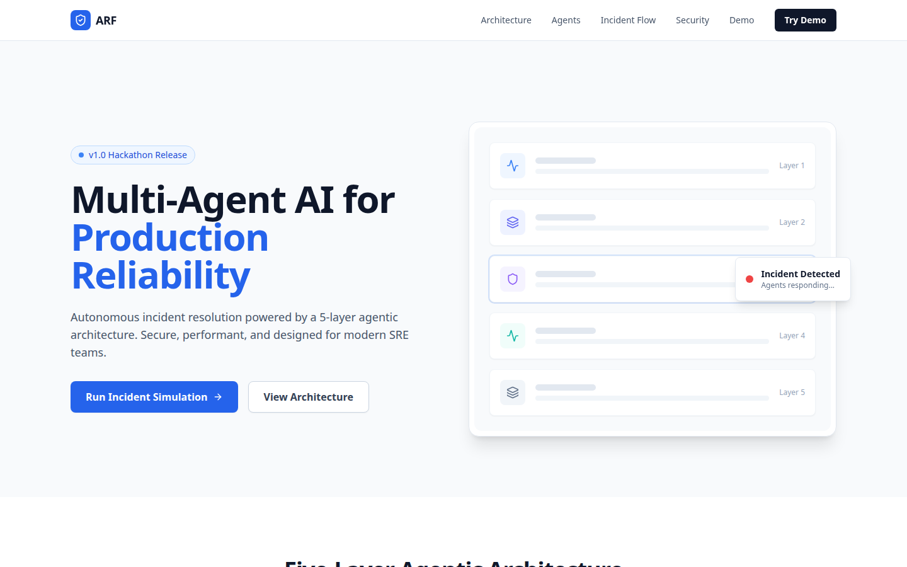
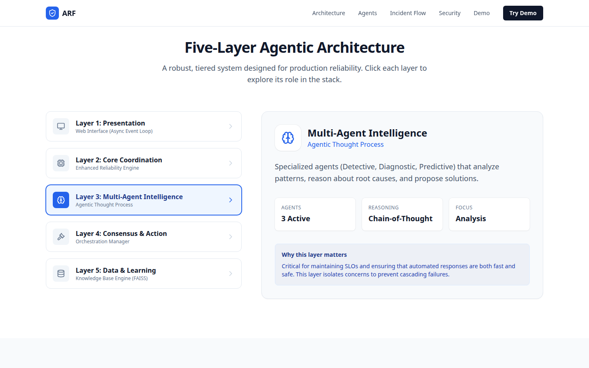
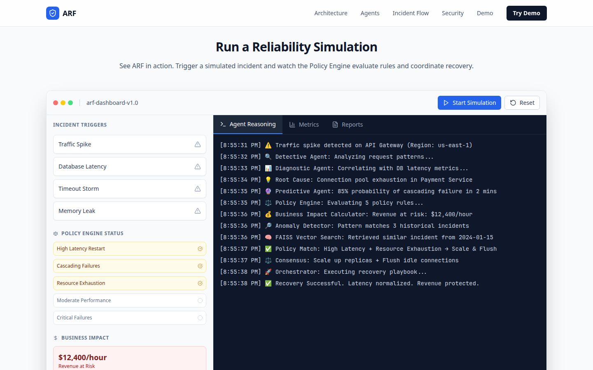
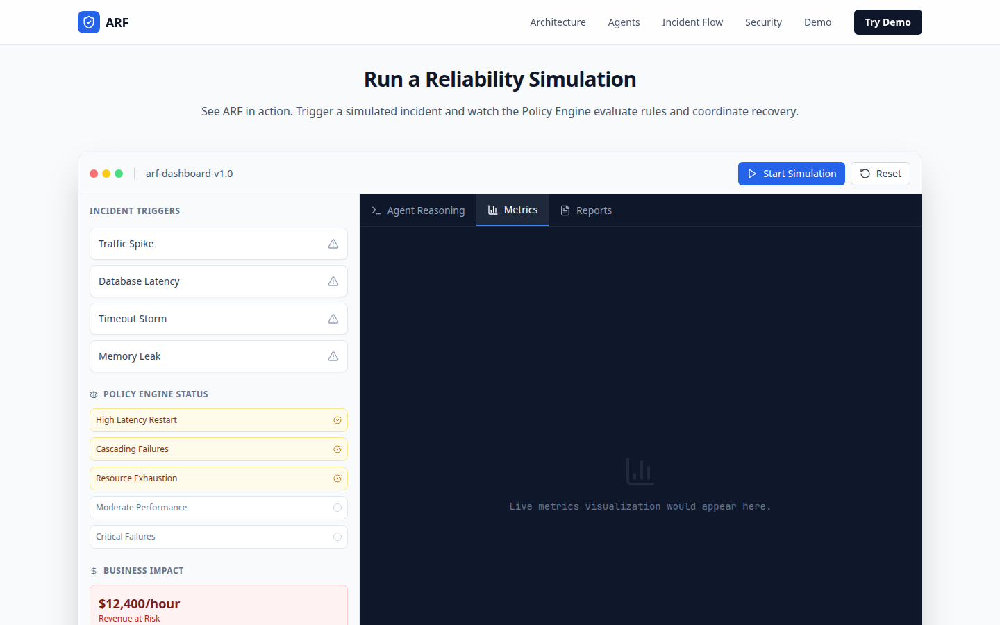
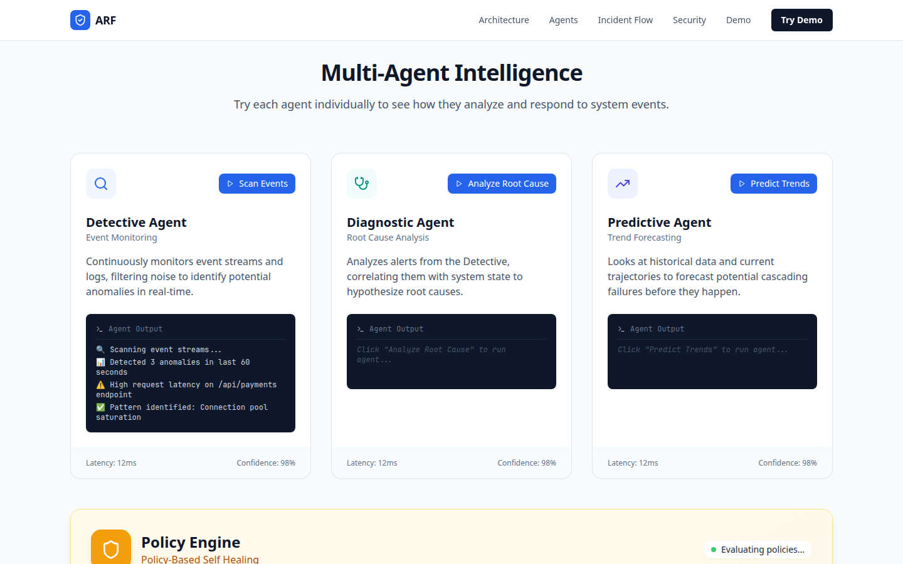
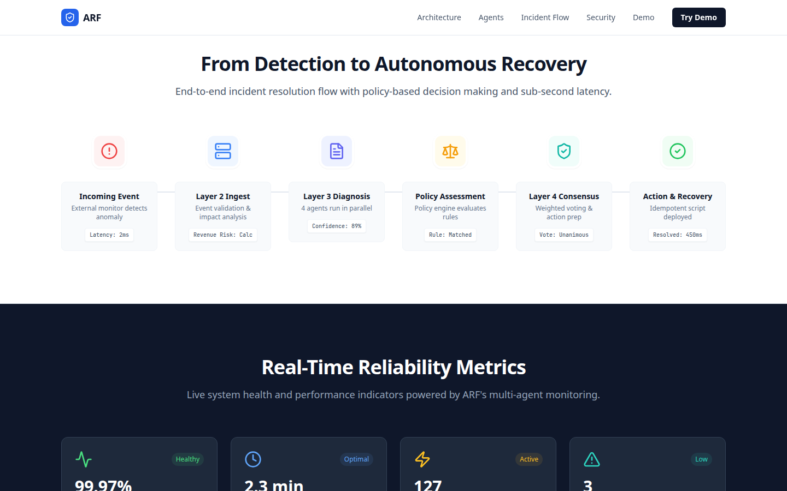
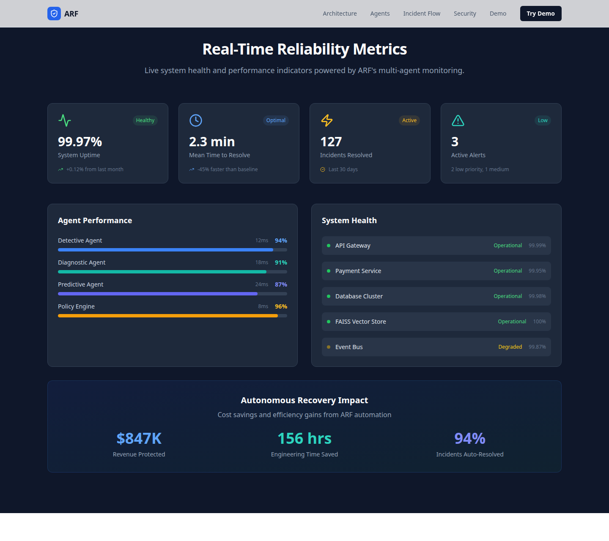
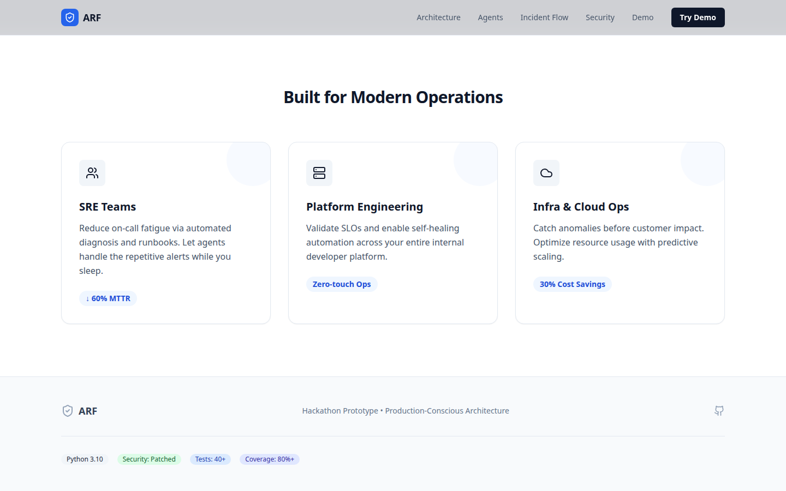
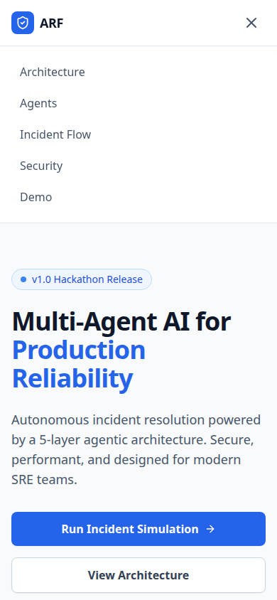

# ARF Marketing Demo

Public portfolio frontend for [Shay Bouchles](https://github.com/shaythegay13). This repository is the second marketing UI for ARF, an AI governance infrastructure layer. The page is a single-screen walkthrough of a five-layer incident-response demo. It was generated in [Magic Patterns](https://magicpatterns.com) from [this design](https://www.magicpatterns.com/c/sfmk7bz4dsiu3zmlhut3gn) and imported through Vercel under the project name `project`.

The GitHub homepage, [project-three-chi-34.vercel.app](https://project-three-chi-34.vercel.app), serves the imported build. The first frontend is [shaythegay13/ARF-Marketing-Demo-UI](https://github.com/shaythegay13/ARF-Marketing-Demo-UI).

Everything on the page is client-side. The incident log, policy matches, agent terminals, and metric figures are constants and timers in the React components. The app does not call an API.

## What the page does

`App` renders one scrolling page: navigation, hero, architecture, demo, agents, incident flow, reliability metrics, use cases, and footer.

| Section | Anchor | What you can do |
| --- | --- | --- |
| Navigation | — | Sticky bar. Desktop links jump to Architecture, Agents, Incident Flow, Security (`#metrics`), and Demo. **Try Demo** also goes to `#demo`. Below the `md` breakpoint the same links open in a menu. |
| Hero | — | States the page title, **Multi-Agent AI for Production Reliability**, with a **v1.0 Hackathon Release** badge, **Run Incident Simulation**, and **View Architecture**. The right side is an abstract five-row stack labeled Layer 1–5 and a floating **Incident Detected** badge. The layer names in source are not drawn on those rows. |
| Architecture | `#architecture` | Five selectable layers. The detail panel shows that layer’s subtitle, description, and three metric chips. **Why this layer matters** is the same paragraph for every layer. |
| Demo | `#demo` | **Start Simulation**, **Reset**, and four triggers (**Traffic Spike**, **Database Latency**, **Timeout Storm**, **Memory Leak**) all play one scripted timeline of about 7.4 seconds. The sidebar then shows three matched policy rules, two unmatched rules, and **$12,400/hour** revenue at risk. Payment Service is labeled Degraded while the timers are running and Healthy otherwise. API Gateway and Database stay Healthy. |
| Agents | `#agents` | Three buttons run canned terminal lines: Detective (**Scan Events**), Diagnostic (**Analyze Root Cause**), and Predictive (**Predict Trends**). Each card always shows **Latency: 12ms** and **Confidence: 98%**. The Policy Engine panel below is a static diagram: five named rules, a Policy Engine → Circuit Breaker → Combined Output flow, and three downstream labels (Business Impact Calculator, Anomaly Detector, FAISS Vector Memory). Its status text stays **Evaluating policies...**. |
| Incident flow | `#flow` | Six static steps from **Incoming Event** through **Action & Recovery**, with fixed meta text such as **Latency: 2ms**, **4 agents run in parallel**, and **Resolved: 450ms**. |
| Reliability metrics | `#metrics` | Static cards: 99.97% uptime, 2.3 min mean time to resolve, 127 incidents, 3 active alerts, per-agent accuracy bars, a five-service health list (Event Bus is **Degraded**), and an impact strip of **$847K**, **156 hrs**, and **94%**. The nav label for this section is **Security**. |
| Use cases | — | Three cards: SRE Teams (**↓ 60% MTTR**), Platform Engineering (**Zero-touch Ops**), Infra & Cloud Ops (**30% Cost Savings**). |
| Footer | — | **Hackathon Prototype • Production-Conscious Architecture**, a GitHub icon whose `href` is `#`, and badges reading Python 3.10, Security: Patched, Tests: 40+, and Coverage: 80%+. |

The demo’s **Agent Reasoning** tab prints the script. The **Metrics** tab prints “Live metrics visualization would appear here.” The **Reports** tab prints “Post-incident reports generated automatically.” Neither tab loads data.

The scripted log, in order:

1. Traffic spike on API Gateway in `us-east-1`
2. Detective Agent analyzing request patterns
3. Diagnostic Agent correlating database latency
4. Root cause: connection pool exhaustion in Payment Service
5. Predictive Agent: 85% probability of cascading failure in 2 minutes
6. Policy Engine evaluating five rules (High Latency Restart, Cascading Failures, and Resource Exhaustion match; Moderate Performance and Critical Failures do not)
7. Business impact of $12,400/hour
8. Anomaly Detector: pattern matches 3 historical incidents
9. FAISS vector search: similar incident from 2024-01-15
10. Policy match: High Latency + Resource Exhaustion → Scale & Flush
11. Consensus: scale up replicas and flush idle connections
12. Orchestrator executing the recovery playbook
13. Recovery successful

The five architecture layers, as written in the page:

| Layer | Title | Subtitle on the page |
| --- | --- | --- |
| 1 | Presentation | Web Interface (Async Event Loop) |
| 2 | Core Coordination | Enhanced Reliability Engine |
| 3 | Multi-Agent Intelligence | Agentic Thought Process |
| 4 | Consensus & Action | Orchestration Manager |
| 5 | Data & Learning | Knowledge Base Engine (FAISS) |

Layer 3’s copy names Detective, Diagnostic, and Predictive agents. Those are the three runnable cards in the agents section.

## Stack

Verified from `package.json` and a local install on Node 22.14.0 / npm 10.9.9.

| Piece | Role |
| --- | --- |
| React 18.3 and React DOM | UI. Entry uses `createRoot`. |
| TypeScript 5.5 | `strict`, `noUnusedLocals`, `noEmit`. JSX runtime is `react-jsx`. |
| Vite 5 | Dev server, build, and preview. The install used for this README resolved Vite 5.4.21. |
| `@vitejs/plugin-react` 4 | React transform. |
| Tailwind CSS 3.4.17, PostCSS, Autoprefixer | Styling. Content paths are `index.html` and `src/**/*.{js,ts,jsx,tsx}`. |
| lucide-react 0.522.0 | Icons. |
| ESLint 8 with `@typescript-eslint` 5, `eslint-plugin-react-hooks`, and `eslint-plugin-react-refresh` | `npm run lint`. |

The npm package name is still `magic-patterns-vite-template` (`private: true`, version `0.0.1`). There is no router, test runner, CSS framework plugin, or backend dependency.

## Architecture

```text
index.html
└── src/index.tsx          createRoot(#root)
    └── src/App.tsx
        ├── Navigation
        ├── Hero
        ├── ArchitectureSection     #architecture
        ├── DemoSection             #demo
        ├── AgentsSection           #agents
        ├── IncidentFlowSection     #flow
        ├── SecurityPerformanceSection   #metrics
        ├── UseCasesSection
        └── Footer
```

State stays inside the component that owns it. Architecture keeps the selected layer. The demo keeps the log lines, the active tab, policy rows, business-impact text, and the in-flight timers. Agents keeps which card is running and that card’s output lines. The other sections are static markup.

The five-layer model is content in `ArchitectureSection`. This repository does not run those layers as services.

## Setup

```bash
npm install
npm run dev       # http://localhost:5173
npm run build     # writes dist/
npm run preview   # serves the production build
npm run lint
npx tsc --noEmit
```

No environment variables are read. `.env.example` lists no names for that reason. `.env` and `.env.*` are gitignored, with an exception for `.env.example`. Copying the example file is optional; the dev server starts without it.

`package-lock.json` is committed. `npm install` and `npm ci` both match this tree.

## How this differs from the first UI

[ARF-Marketing-Demo-UI](https://github.com/shaythegay13/ARF-Marketing-Demo-UI) is the first frontend. Commit `a308410` in this repository (2025-12-05, “Initial commit”, created from `https://vercel.com/new`) matches that repository’s `88c6218` file for file. Both READMEs at those commits were the Magic Patterns template and both cite the same design URL.

| | This repository | ARF-Marketing-Demo-UI |
| --- | --- | --- |
| GitHub name | `ARF-Marketing-Demov2` | `ARF-Marketing-Demo-UI` |
| How it arrived | One Vercel import commit by `shaythegay13` | Three Magic Patterns sync commits by Shay Bouchles, the latest titled `[Magic Patterns] Updated from 'UI: Reorder sections and features'` |
| GitHub description | Empty | “Synced from Magic Patterns” |
| Linked homepage | [project-three-chi-34.vercel.app](https://project-three-chi-34.vercel.app) | None on the GitHub repo |

The sections, copy, and scripted incident are the same design. This branch only changes small defects in that shared page: the Security link target, Tailwind classes that the compiler was dropping, demo reset and log timestamps, the React 18 root, unused imports, and a favicon path that pointed at a missing file. Those edits are listed in the pull request.

## Screenshots

Taken from `npm run dev` on this branch at `http://127.0.0.1:5173` (14 October 2026). Desktop shots are 1440px wide. The metrics shot uses a 1280px-tall viewport so the whole section fits. The phone shot is 390×844.

Hero and the abstract layer stack:



Architecture with Layer 3 selected:



Scripted simulation after the timeline finishes. Policy rows and the $12,400/hour figure are filled in:



Metrics and Reports tabs inside the same demo:




Detective agent after **Scan Events**. Diagnostic and Predictive are still idle:



Incident flow into the top of the metrics band:



Reliability metrics, including the colored accuracy bars and the recovery-impact strip:



Use cases and footer badges:



Mobile navigation:



## Contributors

From `git shortlog` and `git log` on this repository. There is one commit and one author.

| Name | Git author | Commit |
| --- | --- | --- |
| Shay Bouchles ([@shaythegay13](https://github.com/shaythegay13)) | `shaythegay13 <222413861+shaythegay13@users.noreply.github.com>` | [`a308410`](https://github.com/shaythegay13/ARF-Marketing-Demov2/commit/a308410cff987742b020a9f4a86dd4719274377e) — Initial commit, 2025-12-05 |

The GitHub profile name for `shaythegay13` is Shay Bouchles.

## Limits of this demo

- The four incident triggers share one timeline. Choosing **Memory Leak** still prints the API Gateway traffic-spike script.
- **Reset** clears the log, policy rows, business-impact figure, and any timers still pending.
- Log timestamps are the clock time when each line is appended.
- Footer badges and the metric figures are strings in the components. This repository has no Python package, test suite, or coverage report.
- The footer GitHub icon points at `#`.
- The incident-flow card says “4 agents run in parallel.” The agents section has three runnable agents plus the policy engine panel.
- Agent log lines use `animate-in`, `fade-in`, and `slide-in-from-left-2`. Those utilities are not in the installed Tailwind build, so the lines appear without that entrance motion.
- `prose` and `prose-slate` on the architecture paragraph have no matching plugin (`@tailwindcss/typography` is not installed). The paragraph still uses its own text classes.
- The use-cases block has no `id`, so it is not in the nav.
- The phone menu lists the five section links and does not repeat the desktop **Try Demo** button. **Demo** is in that list, and **Run Incident Simulation** remains on the hero.
- `index.html` no longer points at `/vite.svg` (that file was never in the repo). Browsers still request `/favicon.ico` on their own, and this repo has no favicon file, so that request 404s.
- `npm audit` on this install reports 15 advisories in the dev toolchain (3 moderate, 12 high), including `braces`, `postcss-selector-parser`, `esbuild` (pulled in by Vite), and Vite itself. `npm audit fix --force` was not applied; it would move the ESLint 8 toolchain and Vite off the versions this template pins.
- There is no application test suite. Checks that were run are in the pull request.
